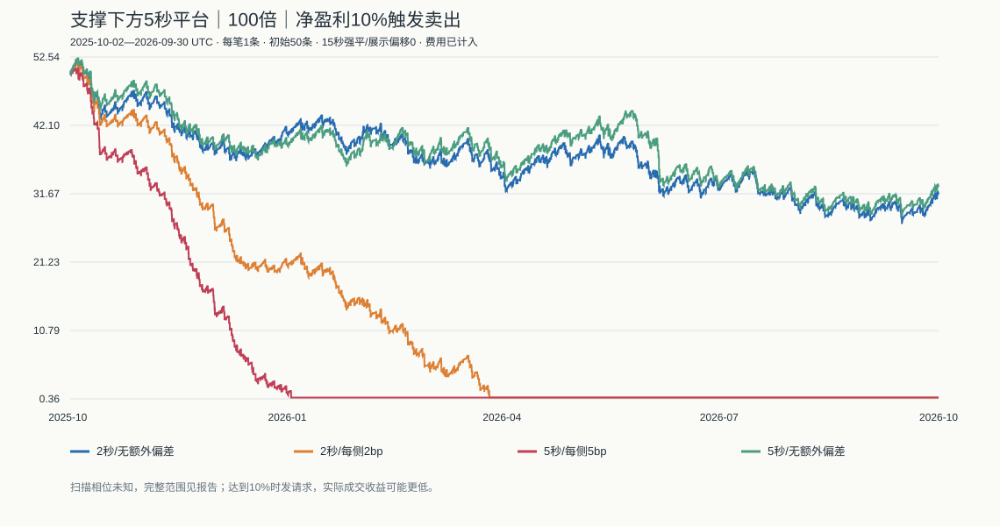

# 支撑下方5秒平台＋100倍＋净盈利10%：扩大范围回测

固定规则实际回测，没有网站买卖。参数来自本轮用户修改，没有按结果调参；所有结果属于探索性历史研究。

## 冻结规则

- BTCUSDT，连续评估2025-10-02 00:00至2026-10-01 00:00 UTC（364天），2025年10月1日仅用于支撑热身；此外逐月重置50条本金独立测试，2025年10月为10月2日起的部分月。
- 支撑沿用15分钟已确认低点：严格低于左右各2根低点，右侧完成后才使用；确认时ATR14冻结，接触区域上沿为S＋0.25ATR，低点起24小时内有效。一处支撑只买一次。
- 不要求4小时上涨。接触支撑后，秒收盘下降至S以下，最多30分钟内寻找平台。平台开始前30秒收盘价收益必须严格为负，不设跌幅门槛。
- 平台为连续5根完整秒线，其最高价全部低于S，最高价/最低价−1≤0.01%；条件成立直接发买入，不等待突破或反弹。
- 50条本金，每笔固定1条，100倍，最多1仓。不使用旧版6小时冷却、日亏损暂停或5%回撤停机，也不添加人工止损和持有超时；亏损退出由平台强平决定。
- 以保证金扣除网站平仓手续费和取整后的净收益≥10%作为卖出触发条件。100倍平价平仓费约为保证金2%，目标对应标的上涨约0.120024%。
- 买卖按触发后的延迟秒收盘成交；场景额外偏差买加卖减。达到10%只发卖出请求，最终收益由延迟成交决定，不保证实际实现10%。
- 强平线为真实入场价×0.99，默认每15秒以当前秒收盘检查，强平到账为0。扫描偏移0秒为展示口径，另外测试0—14秒全部偏移；卖出请求途中仍可能被强平。
- 每秒低价强平另列保守敏感性对照；评估期末未退出仓位按最后秒收盘强制结算，独立列作边界平仓。

## 数据与验证

评估31,449,600秒，连同热身载入31,536,000秒。全部高低收合法，与8760根小时线和2190根4小时线高/低/收一致；最大误差0.00375000美元。

9项专项测试通过，160组逐笔账本、延迟、强平时刻、单仓、固定金额及限频检查通过。源代码、参数和数据保存SHA-256。

原始时间戳与归档校验和未完整保留，聚合一致性不能替代全年原始时间轴核验。平台真实强平周期和取价延迟未实测。

## 15秒强平，展示偏移0秒

| 场景 | 净收益 | 最大回撤 | 自然平仓 | 胜率 | 爆仓 | 盈利目标退出 | 实际低于10%的目标退出 | 期末鱼干 |
|---|---:|---:|---:|---:|---:|---:|---:|---:|
| delay2_no_extra_slippage | -36.8424% | 49.0561% | 1785 | 88.9076% | 198 | 1587 | 181 | 31.5788 |
| delay2_2bp_each_side | -98.8456% | 98.8874% | 873 | 86.1397% | 119 | 754 | 568 | 0.5772 |
| delay5_5bp_each_side | -98.8852% | 98.9033% | 429 | 81.5851% | 73 | 356 | 320 | 0.5574 |
| delay5_no_extra_slippage | -34.5504% | 47.0996% | 1788 | 88.7025% | 200 | 1588 | 305 | 32.7248 |

无额外偏差场景仍收取网站平仓费。2bp、5bp指每侧额外不利偏差；delay为买卖共同延迟秒数。

## 强平扫描相位敏感性

| 场景 | 15种偏移最低收益 | 最高收益 | 爆仓次数范围 |
|---|---:|---:|---:|
| delay2_no_extra_slippage | -48.8376% | -35.0258% | 197—204 |
| delay2_2bp_each_side | -99.9420% | -98.3644% | 110—120 |
| delay5_5bp_each_side | -99.3604% | -98.3146% | 72—74 |
| delay5_no_extra_slippage | -40.0154% | -27.7132% | 197—203 |

偏移是未知执行条件，不是调参候选；不能挑最有利的一行作为现场可实现收益。

## 每秒低价强平的保守对照

| 场景 | 净收益 | 最大回撤 | 自然平仓 | 爆仓 |
|---|---:|---:|---:|---:|
| delay2_no_extra_slippage | -64.5242% | 74.3945% | 1802 | 212 |
| delay2_2bp_each_side | -98.8838% | 99.1879% | 697 | 104 |
| delay5_5bp_each_side | -98.9010% | 98.9188% | 363 | 69 |
| delay5_no_extra_slippage | -55.9454% | 66.3737% | 1806 | 211 |

## 主要诊断

支撑接触3420次，满足“此前30秒下跌＋5秒平台”的候选2485次。主场景自然平仓1785笔，收益-36.8424%，最大回撤49.0561%。

单笔平均盈利保证金收益11.3390%，平均亏损-100.0000%，PF=0.909，持有时长中位数912秒，最长160515秒。

主场景有11笔曾在秒内最低价触及爆仓线、但未被15秒收盘扫描强平后退出。该计数不等于可重复的套利，需要结合保守对照和相位范围看待。

若每笔盈利恰为投入的10%、爆仓亏损100%，理论盈亏平衡胜率约90.91%；实际应按真实成交后的平均盈亏计算。不能用目标触发次数代替盈利次数，也不能遗漏期末未平仓的损失。

期末边界平仓1笔；账户收益包含这笔结算，胜率和自然交易数不包含。跳过原因：{"position_or_order_busy":699}。

本轮固定规则扩大历史范围，不是独立样本外验证；9月及其他历史价格已被以前研究查看过。没有实测成交偏差、拒单、断线或会话失效；始终liveQualified=false。



## 复现与证据

```sh
node --test research/support-platform-100x-v1/strategy.test.mjs
node research/support-platform-100x-expanded-v1/run.mjs
```

每次创建新目录。frozen-policy.json为参数，events.jsonl为全部机会，results.json为全年64组及逐月96组汇总，各-trades.json为逐笔，ledger-audit.json为账本核验，tests.txt为测试输出。

## 逐月独立账户

每月重置50条本金，固定每笔1条；月末强制结算。此表用于观察不同月份，不能把收益相乘当作全年账户。2025年10月从2日开始。每格为账户收益；强平15秒、偏移0。

| 月份 | BTC涨跌 | 2秒/无额外偏差 | 2秒/每侧2bp | 5秒/每侧5bp | 5秒/无额外偏差 |
|---|---:|---:|---:|---:|---:|
| 2025-10 | -7.5785% | -8.2416% | -14.6204% | -29.6200% | -5.0804% |
| 2025-11 | -17.5608% | -14.8380% | -27.2668% | -38.0630% | -16.2714% |
| 2025-12 | -3.0011% | 4.8458% | -16.4612% | -29.5946% | -0.2008% |
| 2026-01 | -10.1624% | -1.6792% | -11.0918% | -26.6148% | -2.3788% |
| 2026-02 | -14.9450% | -7.2366% | -19.6988% | -33.0908% | -2.6690% |
| 2026-03 | 1.9671% | -4.8544% | -17.8548% | -34.2424% | -2.0768% |
| 2026-04 | 11.8212% | 6.4220% | -5.8830% | -13.0316% | 9.0734% |
| 2026-05 | -3.4894% | -1.4640% | -9.2494% | -23.2320% | 1.7544% |
| 2026-06 | -20.4393% | -8.3114% | -28.4174% | -47.4720% | -16.4378% |
| 2026-07 | 7.2719% | -3.0468% | -8.3672% | -20.5798% | -2.5572% |
| 2026-08 | 24.9546% | -4.9318% | -10.7630% | -17.0068% | -4.5294% |
| 2026-09 | 6.4167% | 5.5776% | -4.8940% | -16.7868% | 5.9100% |

## 跨月稳定性与连续账户

- delay2_no_extra_slippage：独立账户盈利3/12个月；最差2025-11 -14.8380%，最好2026-04 6.4220%。
- delay2_2bp_each_side：独立账户盈利0/12个月；最差2026-06 -28.4174%，最好2026-09 -4.8940%。
- delay5_5bp_each_side：独立账户盈利0/12个月；最差2026-06 -47.4720%，最好2026-04 -13.0316%。
- delay5_no_extra_slippage：独立账户盈利3/12个月；最差2026-06 -16.4378%，最好2026-04 9.0734%。

全年账户连续持仓与现金，只有全年末才强制结算。如果现金不足1条，后续信号跳过，不追加资金。全年最大回撤按每秒扣费后的可退出净值计算；逐月独立账户另行重置。

全年64组执行条件＋逐月96组共160组均经过账本核验。逐月只展示相位0，不宣称覆盖每月全部扫描时点。
