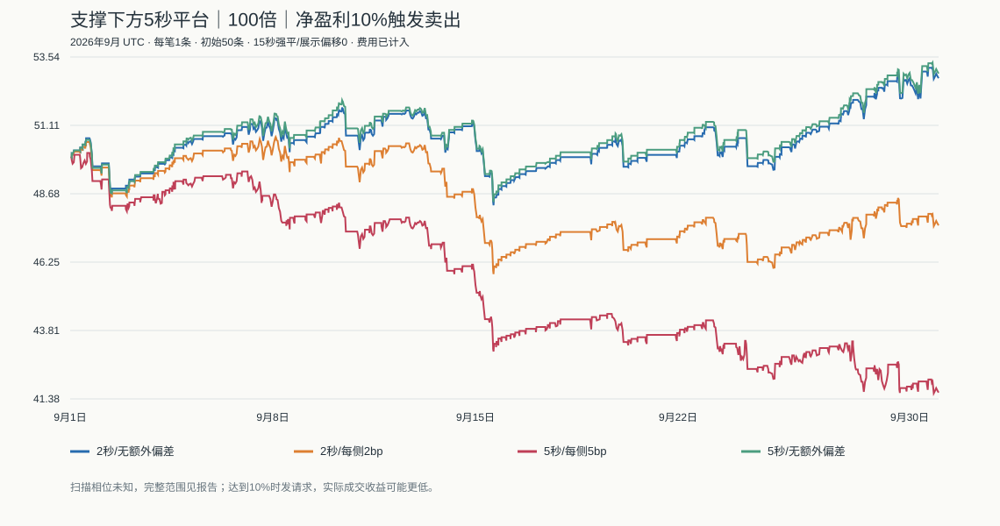

# 支撑下方5秒平台＋100倍＋净盈利10%：2026年9月回测

固定规则实际回测，没有网站买卖。参数来自本轮用户修改，没有按结果调参；所有结果属于探索性历史研究。

## 冻结规则

- BTCUSDT，评估2026-09-01 00:00至2026-10-01 00:00 UTC，8月31日秒线仅用于支撑热身。
- 支撑沿用15分钟已确认低点：严格低于左右各2根低点，右侧完成后才使用；确认时ATR14冻结，接触区域上沿为S＋0.25ATR，低点起24小时内有效。一处支撑只买一次。
- 不要求4小时上涨。接触支撑后，秒收盘下降至S以下，最多30分钟内寻找平台。平台开始前30秒收盘价收益必须严格为负，不设跌幅门槛。
- 平台为连续5根完整秒线，其最高价全部低于S，最高价/最低价−1≤0.01%；条件成立直接发买入，不等待突破或反弹。
- 50条本金，每笔固定1条，100倍，最多1仓。不使用旧版6小时冷却、日亏损暂停或5%回撤停机，也不添加人工止损和持有超时；亏损退出由平台强平决定。
- 以保证金扣除网站平仓手续费和取整后的净收益≥10%作为卖出触发条件。100倍平价平仓费约为保证金2%，目标对应标的上涨约0.120024%。
- 买卖按触发后的延迟秒收盘成交；场景额外偏差买加卖减。达到10%只发卖出请求，最终收益由延迟成交决定，不保证实际实现10%。
- 强平线为真实入场价×0.99，默认每15秒以当前秒收盘检查，强平到账为0。扫描偏移0秒为展示口径，另外测试0—14秒全部偏移；卖出请求途中仍可能被强平。
- 每秒低价强平另列保守敏感性对照；月末未退出仓位按最后秒收盘强制结算，独立列作边界平仓。

## 数据与验证

评估2,592,000秒，连同热身载入2,678,400秒。全部高低收合法，与744根小时线和186根4小时线高/低/收一致；最大误差0.00375000美元。

9项专项测试通过，64组逐笔账本、延迟、强平时刻、单仓、固定金额及限频检查通过。源代码、参数和数据保存SHA-256。

原始时间戳与归档校验和未完整保留，聚合一致性不能替代全年原始时间轴核验。平台真实强平周期和取价延迟未实测。

## 15秒强平，展示偏移0秒

| 场景 | 净收益 | 最大回撤 | 自然平仓 | 胜率 | 爆仓 | 盈利目标退出 | 实际低于10%的目标退出 | 期末鱼干 |
|---|---:|---:|---:|---:|---:|---:|---:|---:|
| delay2_no_extra_slippage | 5.5776% | 7.6535% | 138 | 92.0290% | 11 | 127 | 5 | 52.7888 |
| delay2_2bp_each_side | -4.8940% | 10.5260% | 131 | 90.0763% | 13 | 118 | 100 | 47.5530 |
| delay5_5bp_each_side | -16.7868% | 17.8062% | 124 | 87.9032% | 15 | 109 | 103 | 41.6066 |
| delay5_no_extra_slippage | 5.9100% | 7.8849% | 137 | 91.2409% | 11 | 126 | 13 | 52.9550 |

无额外偏差场景仍收取网站平仓费。2bp、5bp指每侧额外不利偏差；delay为买卖共同延迟秒数。

## 强平扫描相位敏感性

| 场景 | 15种偏移最低收益 | 最高收益 | 爆仓次数范围 |
|---|---:|---:|---:|
| delay2_no_extra_slippage | 4.1798% | 5.5776% | 11—12 |
| delay2_2bp_each_side | -4.8940% | -2.0150% | 12—13 |
| delay5_5bp_each_side | -16.9172% | -16.7868% | 15—15 |
| delay5_no_extra_slippage | 2.3234% | 5.9100% | 11—13 |

偏移是未知执行条件，不是调参候选；不能挑最有利的一行作为现场可实现收益。

## 每秒低价强平的保守对照

| 场景 | 净收益 | 最大回撤 | 自然平仓 | 爆仓 |
|---|---:|---:|---:|---:|
| delay2_no_extra_slippage | 4.5912% | 7.4420% | 144 | 12 |
| delay2_2bp_each_side | -4.1884% | 10.3098% | 135 | 13 |
| delay5_5bp_each_side | -16.9172% | 17.9363% | 123 | 15 |
| delay5_no_extra_slippage | 2.7188% | 9.7959% | 143 | 13 |

## 主要诊断

支撑接触288次，满足“此前30秒下跌＋5秒平台”的候选219次。主场景自然平仓138笔，收益5.5776%，最大回撤7.6535%。

单笔平均盈利保证金收益11.1493%，平均亏损-100.0000%，PF=1.287，持有时长中位数1290秒，最长69957秒。

主场景有1笔曾在秒内最低价触及爆仓线、但未被15秒收盘扫描强平后退出。该计数不等于可重复的套利，需要结合保守对照和相位范围看待。

若每笔盈利恰为投入的10%、爆仓亏损100%，理论盈亏平衡胜率约90.91%；实际应按真实成交后的平均盈亏计算。不能用目标触发次数代替盈利次数，也不能遗漏月末未平仓的损失。

月末边界平仓1笔；账户收益包含这笔结算，胜率和自然交易数不包含。跳过原因：{"position_or_order_busy":80}。

本月已被以前研究查看过，不能称为独立样本外验证。没有实测成交偏差、拒单、断线或会话失效；始终liveQualified=false。



## 复现与证据

```sh
node --test research/support-platform-100x-v1/strategy.test.mjs
node research/support-platform-100x-v1/run.mjs
```

每次创建新目录。frozen-policy.json为参数，events.jsonl为全部机会，results.json为64组汇总，各-trades.json为逐笔，ledger-audit.json为账本核验，tests.txt为测试输出。
