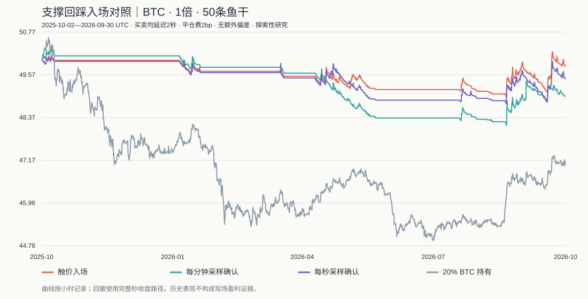

# 支撑回踩＋秒级确认：第一版历史研究

完成于 2026年10月2日星期五 23:05:48。

实际执行的固定规则回测，没有按结果调参，没有提交网站订单。数据已被以前的研究查看过，全部结果是探索性证据，不是独立样本外验证。

## 冻结规则

- BTCUSDT、1倍、50条鱼干、单仓。秒线覆盖2025-10-01至2026-09-30 UTC；首24小时用于支撑热身，实际评估从2025-10-02 UTC起。
- 最近已收盘4小时线收盘价>EMA200且EMA50>EMA200才允许入场。EMA以初始N根均值初始化，预热从2025年3月开始。
- 15分钟低点严格低于左右各2根低点，右侧2根完成后确认。确认时的Wilder ATR14冻结；中心S，区域S±0.25ATR，失效线S−0.5ATR。支撑从低点开始最多保留96根15分钟线。
- 每根15分钟线完成后，从未使用、未失效的支撑中选最近且低于现价的一个；秒收盘进入上沿以下形成回调事件。一处支撑只使用一次，事件最长等待30分钟。
- 秒级确认：至少15秒不创新的秒线最低价，当前秒收盘≥S、≤S＋ATR，并突破此前10秒最高价。分钟对照为完全相同条件，仅每分钟结束检查；触价对照在事件开始触发。
- 每笔投入≤净值20%、计划损失≤净值0.25%；预留0.02%平仓费及每侧0.05%执行预算。最低1条、向下取整4位。止损距离超过4%不入场。金额在发请求时确定，不能利用后续价格取消或改金额。
- 初始止损是冻结失效线；每小时更新“入场后最高完整小时收盘−3倍小时ATR14”，只上移。趋势关闭或持有满48小时退出；平仓后冷却6小时。
- 北京时间日内净值损失1%退出并暂停至次日，净值高点回撤5%退出并永久停机。跨季度继承现金、持仓与风控，不重置。阈值不能保证损失上限。
- 平仓收费一次，按网站1倍公式floor至0.0001条。使用信号后延迟的秒收盘成交，买加卖减场景偏差；止损不假定能按旧止损价成交。

## 数据检查

检查31,536,000根秒线，全部数值及高低收关系通过。对照8760根小时线和2190根4小时线的高/低/收，最大误差分别0.00375000、0.00375000美元（容差0.02美元）。全部输入和代码保存SHA-256。

旧导入器未保存原始时间戳和ZIP校验和，缺口计数有已知问题。聚合一致性不能替代逐条时间戳核验。原数据只读。

另从公开归档抽查固定3天，成功核验86,400秒原始时间戳和高/低/收float32数值；失败请求的原因保留在original-archive-spotcheck.json。抽查不能证明全年完整性。

12项策略测试通过，15组逐笔账本独立重算通过，检查成交延迟、单仓、冷却、金额和风险预算；详见tests.txt和independent-ledger-audit.json。

## 实际结果

### delay2_no_extra_slippage

买卖延迟均2秒，每侧额外不利偏差0bp；平仓2bp另计。

| 入场方式 | 净收益 | 最大回撤 | 自然平仓数 | 胜率 | PF | 平均持有小时 | 期末鱼干 |
|---|---:|---:|---:|---:|---:|---:|---:|
| 触价入场 | -0.3944% | 2.5545% | 233 | 9.8712% | 0.952 | 4.059 | 49.8028 |
| 每分钟采样确认 | -2.0628% | 4.4730% | 170 | 13.5294% | 0.732 | 5.710 | 48.9686 |
| 每秒采样确认 | -1.1000% | 2.9135% | 222 | 9.9099% | 0.866 | 4.382 | 49.4500 |

### delay2_2bp_each_side

买卖延迟均2秒，每侧额外不利偏差2bp；平仓2bp另计。

| 入场方式 | 净收益 | 最大回撤 | 自然平仓数 | 胜率 | PF | 平均持有小时 | 期末鱼干 |
|---|---:|---:|---:|---:|---:|---:|---:|
| 触价入场 | -2.2420% | 3.8306% | 233 | 8.5837% | 0.770 | 4.059 | 48.8790 |
| 每分钟采样确认 | -4.2900% | 5.0013% | 113 | 8.8496% | 0.301 | 4.991 | 47.8550 |
| 每秒采样确认 | -2.8480% | 4.2875% | 222 | 9.9099% | 0.708 | 4.382 | 48.5760 |

### delay5_5bp_each_side

买卖延迟均5秒，每侧额外不利偏差5bp；平仓2bp另计。

| 入场方式 | 净收益 | 最大回撤 | 自然平仓数 | 胜率 | PF | 平均持有小时 | 期末鱼干 |
|---|---:|---:|---:|---:|---:|---:|---:|
| 触价入场 | -4.7802% | 5.0082% | 151 | 7.2848% | 0.399 | 3.631 | 47.6099 |
| 每分钟采样确认 | -4.4146% | 5.0004% | 81 | 7.4074% | 0.189 | 5.189 | 47.7927 |
| 每秒采样确认 | -4.7936% | 5.0041% | 125 | 8.0000% | 0.309 | 3.845 | 47.6032 |

### delay5_no_extra_slippage

买卖延迟均5秒，每侧额外不利偏差0bp；平仓2bp另计。

| 入场方式 | 净收益 | 最大回撤 | 自然平仓数 | 胜率 | PF | 平均持有小时 | 期末鱼干 |
|---|---:|---:|---:|---:|---:|---:|---:|
| 触价入场 | -0.5168% | 2.5444% | 233 | 9.4421% | 0.937 | 4.059 | 49.7416 |
| 每分钟采样确认 | -2.1624% | 4.5464% | 170 | 12.9412% | 0.723 | 5.710 | 48.9188 |
| 每秒采样确认 | -1.2690% | 3.0290% | 222 | 9.9099% | 0.848 | 4.382 | 49.3655 |

### delay15_no_extra_slippage

买卖延迟均15秒，每侧额外不利偏差0bp；平仓2bp另计。

| 入场方式 | 净收益 | 最大回撤 | 自然平仓数 | 胜率 | PF | 平均持有小时 | 期末鱼干 |
|---|---:|---:|---:|---:|---:|---:|---:|
| 触价入场 | -0.3196% | 2.4584% | 233 | 10.7296% | 0.960 | 4.059 | 49.8402 |
| 每分钟采样确认 | -2.1274% | 4.5468% | 170 | 12.9412% | 0.729 | 5.710 | 48.9363 |
| 每秒采样确认 | -1.1990% | 2.9473% | 221 | 10.4072% | 0.856 | 4.401 | 49.4005 |

### 基准

| 基准 | 净收益 | 最大回撤 |
|---|---:|---:|
| 现金 | 0% | 0% |
| 初始20% BTC持有＋现金 | -5.9056% | 11.3824% |
| 初始100% BTC持有＋现金 | -29.5278% | 54.1926% |

基准不再平衡，使用2秒入场延迟、零额外偏差；不含策略止损和账户停机，仅供行情与敞口背景比较。

### 连续组合季度归因（2秒延迟、零额外偏差）

| 截止日期UTC（不含） | 触价 | 分钟确认 | 秒级确认 |
|---|---:|---:|---:|
| 2026-01-01 | -0.0564% | 0.1998% | -0.1098% |
| 2026-04-01 | -0.8935% | -0.9701% | -0.9348% |
| 2026-07-01 | -0.7554% | -2.5465% | -1.2634% |
| 2026-10-01 | 1.3257% | 1.2784% | 1.2218% |

### 机会覆盖与触发价格

确认低点4724个，支撑回调事件1126次。

| 方式 | 确认次数 | 覆盖率 | 确认样本平均价格改善bp | 等待中位秒 |
|---|---:|---:|---:|---:|
| 触价入场 | 1126 | 100.0000% | 0.000 | 0 |
| 每分钟采样确认 | 521 | 46.2700% | -5.071 | 370 |
| 每秒采样确认 | 988 | 87.7442% | -0.685 | 40 |

价格改善=同一事件触价价格/确认价格−1，正值表示更便宜。只计算已确认样本，包含未被组合实际买入的机会，不是交易收益。全部事件以及忙碌/冷却/风控等过滤计数保留。

## 判断与边界

秒级确认主场景净收益-1.1000%、最大回撤2.9135%、自然平仓222笔。成本与延迟敏感性见各场景。不能凭更少交易、更低回撤或更便宜的触发价判定盈利优势。

秒级确认全部交易的账户损益加回实际平仓费后为-0.1959%，因此本版损失不能全部归因于手续费。

无独立样本外和现场执行证据，始终liveQualified=false。1秒OHLC缺少秒内先后顺序，网站REST取价不必等于秒收盘；未模拟拒单、断线、会话到期和限频。延迟可能使计划风险超标，汇总保留fillRiskExceedances。

继续研究应先实测平台延迟和成交偏差，再冻结下一版规则并观察新数据；不能把已查看年份重命名为封存样本。



## 复现

```sh
node --test research/support-seconds-v1/strategy.test.mjs
node research/support-seconds-v1/run.mjs
```

每次创建新时间戳目录。SUPPORT_SECONDS_DATA和SUPPORT_BARS_DATA可指定同格式输入。results.json为汇总；frozen-policy.json为冻结参数；events.jsonl为全部机会；各-trades.json和-curve.json保存逐笔与曲线；data-audit.json保存数据检查；tests.txt保存本次测试输出。
